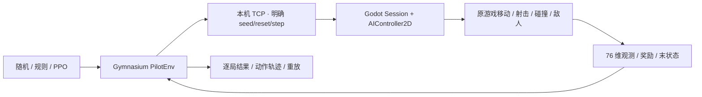

# GamePilot

**让自己的 Godot 游戏成为可训练、可评测、可重放的真实环境。**

基于胡宸凡的 Godot 2D 生存射击游戏《冥日芳粥：肿么滴 demo》（`Huhuhuc/2dshootgame`），学习 Godot RL Agents 的接口设计，接入 Stable-Baselines3 PPO。保留原地图、玩家、子弹、敌人、Buff、碰撞与伤害，比较随机操作、规则 Bot 和学习策略。

这是强化学习试玩与 LLM 工具调用 Agent 项目，不宣称 PPO 或基础大模型为原创算法。为遵守素材再分发边界，公开仓库不包含原游戏音频、字体、美术图片或游戏预览图。先运行 `powershell -ExecutionPolicy Bypass -File .\restore-game-assets.ps1`，从 `sources.json` 固定的原游戏提交下载素材到本地，再按下方步骤运行。素材来源与边界见 [THIRD_PARTY.md](THIRD_PARTY.md)。

## 直接打开

- `watch-agent.bat`：观看规则 Bot 玩原版游戏；这是手写基线。
- `watch-ppo.bat`：观看训练模型，需要本地已有 `runs/original-seed0-100k/best.zip`。
- `play-game.bat`：自己玩，WASD 移动，方向键射击。
- `powershell -ExecutionPolicy Bypass -File .\run.ps1 -Mode Verify`：运行真实 Godot 测试与重置/重放检查。

需 Godot 4.6.1、Python 3.12。当前机器自动检测 `D:\godot v4.6.1`；其他机器设置 `GODOT_BIN`，或向 run.ps1 传 `-Godot "完整路径"`。首次运行缺少 Python 环境时，脚本按锁文件安装依赖。手动初始化：

```powershell
uv venv .venv --python 3.12
uv pip install --python .venv/Scripts/python.exe -r requirements.lock.txt
# 完整 Godot 导入是首次运行前的必要步骤
& $env:GODOT_BIN --headless --path game --editor --import --quit
.\.venv\Scripts\python.exe -m gamepilot.smoke
```

## 实现了什么



- 76 维结构化观测：玩家 12 项、最近 6 个敌人各 8 项、最近 2 个道具各 4 项、8 向墙体距离；不是像素视觉输入。
- `MultiDiscrete([9,9])`：移动和射击分别为静止/不射击＋八方向，每次动作推进 4 个物理帧。
- 原版关卡 60 秒生存目标，死亡/通关自然终止；外部限步另标截断。断连属于错误，不算游戏成功或正常失败。
- 重置整局实例，清除子弹、敌人、掉落、Buff 与计时；刷新和敌人掉落使用可追溯随机种子。
- 奖励 v1：每游戏秒 +0.02、每次敌人死亡 +0.2、每点生命损失 -0.5、死亡 -2、通关 +2。连锁死亡计入总击杀事件，不等同于直接射杀归因。
- 原始死亡动画长度转为固定物理计时后触发训练模式的爆炸/掉落，减少渲染速度对结算的影响。人工模式仍由动画事件驱动。
- 复用上游 AIController2D 与 GodotEnv 协议/空间构建；新增适配器处理 0.8.1 中的 reset seed、info、终止语义、分包读取与进程退出问题。

## 训练、对照与重放

```powershell
# 先检查链路，再扩大训练；输出目录必须是新目录，避免覆盖实验
.\.venv\Scripts\python.exe -m gamepilot.experiment train --steps 10000 --difficulty easy --output runs/first-easy
.\.venv\Scripts\python.exe -m gamepilot.experiment train --steps 100000 --difficulty original --resume runs/first-easy/last.zip --output runs/first-original

# 同一批 30 个独立测试种子：随机、规则、PPO
.\.venv\Scripts\python.exe -m gamepilot.experiment evaluate --model runs/first-original/best.zip --episodes 30 --start-seed 2000 --output runs/comparison

# 验证某一局的动作重放，代码哈希必须匹配；加 --visible 可观看
.\.venv\Scripts\python.exe -m gamepilot.experiment replay --trace runs/comparison/ppo-traces.jsonl --episode 0
```

训练每 10,000 步在验证种子 1000–1009 上保存记录，按平均存活时间＋0.01×平均击杀选择 best，最后保存 last。PPO 按完整 rollout 收集，实际步数可能略大于请求步数，config.json 记录实际值。训练种子与环境种子、验证种子、测试种子用途分开；不要根据测试结果挑 best。

`results.json` 保存各策略逐局指标；`report.html` 是可打开的对照页；`*-traces.jsonl` 保存 seed、动作、奖励、关键状态和代码哈希。异常不吞掉，失败实验保留。重放只验证同版本同平台，不承诺不同系统的物理浮点一致。

## 任务集评测

`tasks/` 定义了四种可复现目标：60 秒生存、限时击杀目标、受伤上限生存、收集道具后完成生存。任务目标和 PPO 奖励分开；任务结果根据游戏 episode 信息判定，超时截断和执行错误不会冒充任务失败。

```powershell
# 单任务 smoke；所有结果写入新的目录
.\.venv\Scripts\python.exe -m gamepilot.experiment evaluate-tasks --task-id kill_target --episodes 3 --start-seed 2000 --output runs/task-smoke

# 全任务 × 随机/规则策略；如要加入 PPO，提供本地模型路径
.\.venv\Scripts\python.exe -m gamepilot.experiment evaluate-tasks --output runs/task-suite
.\.venv\Scripts\python.exe -m gamepilot.experiment evaluate-tasks --model runs/original-seed0-100k/best.zip --output runs/task-suite-ppo
```

输出包括带任务哈希和模型代码哈希的逐局 JSON、CSV 与动作轨迹，以及成功率/失败原因汇总 HTML。不同任务或代码哈希不能合并解释；内置任务的默认测试种子从 2000 开始。该功能是任务评测基准，不代表 PPO 已学会任务或已超过规则策略。

## LLM 游戏任务 Agent

`evaluate-llm` 是独立于 PPO 的工具调用 Agent。模型每轮只能请求 `step_game(move, shoot, repeat)`；参数由本地严格校验，runner 在每个游戏步后检查任务完成/死亡，模型不能重置环境、改种子或自行报告成功。首版读取与 PPO 相同的 76 维结构化状态，不读图像、不训练模型。每局默认向模型提供最近 4 次的动作、状态变化和任务结果摘要，可用 `--history-window 0..16` 调整；不保存或回传模型思维过程，跨局会清空记忆。

支持两种动作接口：本地 Ollama 使用 `/api/chat` 的 JSON Schema 约束动作输出，runner 解析、严格校验后执行；OpenAI-compatible 服务使用原生 function calling。Ollama 的结构化输出不等同于模型自主调用工具。PowerShell 示例：

```powershell
$env:GAMEPILOT_LLM_PROVIDER = "ollama"
$env:GAMEPILOT_LLM_MODEL = "qwen3:4b" # 换成 Ollama 中已经安装且支持结构化输出的模型
# 可选：$env:GAMEPILOT_LLM_BASE_URL = "http://127.0.0.1:11434"
# 可选：$env:GAMEPILOT_LLM_TIMEOUT_SECONDS = "90"
# 可选：$env:GAMEPILOT_LLM_MAX_COMPLETION_TOKENS = "768"
.\.venv\Scripts\python.exe -m gamepilot.experiment evaluate-llm --task-id kill_target --episodes 1 --start-seed 2000 --output runs/llm-smoke
```

兼容云端服务时设置 `GAMEPILOT_LLM_PROVIDER=openai_compatible`、`GAMEPILOT_LLM_BASE_URL`、`GAMEPILOT_LLM_MODEL` 和 `GAMEPILOT_LLM_API_KEY`。密钥只从进程环境读取；报告中的服务地址会去除用户信息和查询参数。云端请求强制选择 `step_game` function；Ollama 请求以动态 `repeat` 上限生成严格 JSON Schema，并通过 `options.num_predict` 限制生成长度。单次生成默认最多 768 token，可用 `GAMEPILOT_LLM_MAX_COMPLETION_TOKENS` 设置为 64–8192；每局有默认 60 次请求上限，可用 `--max-requests-per-episode` 调整；可选 `--max-tokens-per-episode` 限制服务端报告的 Token 总数，单次请求超时可用 `GAMEPILOT_LLM_TIMEOUT_SECONDS` 设置为 1–600 秒。报告记录任务结果、动作、延迟、失败请求数和服务端 token 用量；API/参数错误及预算耗尽计为无效 episode，不记成游戏失败。最多对格式错误的动作输出修复一次。

任务矩阵示例：

```powershell
.\.venv\Scripts\python.exe -m gamepilot.experiment evaluate-llm --output runs/llm-task-suite
```

两次运行后可生成严格配对对照；任务哈希和每局种子不一致时会拒绝比较，无效局会单独计数：

```powershell
.\.venv\Scripts\python.exe -m gamepilot.experiment compare-task-runs `
  --baseline runs/task-suite/results.json `
  --llm runs/llm-task-suite/results.json `
  --task-id kill_target --baseline-policy rule `
  --output runs/paired-kill-comparison
```

报告包含各策略 Wilson 95% 成功率区间和共同有效 seed 的描述性配对差异；没有做显著性检验，不应把差异称为统计显著。

真实模型运行受模型版本、机器和服务延迟影响，应与随机/规则/PPO 使用相同任务版本和种子，并披露无效 episode、模型名称及日期。离线单测使用本地模拟 HTTP 服务；没有本地 Ollama 或 API 服务时，不会有真实模型效果数据。

任务集一粒度 smoke 结果见 [task-suite-smoke.md](docs/task-suite-smoke.md)。它验证评测闭环，不是模型能力结论。LLM Agent 设计见 [设计稿](docs/superpowers/specs/2026-11-10-llm-game-task-agent-design.md)。

本地 Ollama JSON Schema 接口的真实模型 smoke 记录见 [llm-provider-smoke.md](docs/llm-provider-smoke.md)。当前记录因单局 Token 预算触发而无效，只证明结构化动作解析、runner 执行和预算停止链路；不代表 `kill_target` 完成，也不能作为模型能力成绩。
模块边界与数据流见 [架构说明](docs/architecture.md)，可复现对照流程见 [评测协议](docs/evaluation-protocol.md)。
面向简历的准确项目条目和当前验证边界见 [resume-entry.md](docs/resume-entry.md)。

## 真实边界

PPO 需要学习，安装成功或训练跑完不代表会玩。规则 Bot 可能明显优于短训策略；最终能力以实际评测为准。当前是单进程单游戏、CPU MLP，没有多 Agent、视觉输入、自动找 Bug 或自动改平衡参数。卡住计数只是启发式记录。

最初的研究与计划：[研究](docs/research.md) · [设计](docs/design.md) · [实现计划](docs/implementation-plan.md)。上游和原游戏提交记录在 sources.json。模型与完整实验位于本地 runs/，不自动提交到 Git。
