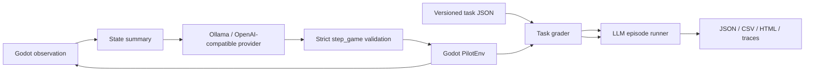

# GamePilot Architecture

## Runtime Boundary

Godot owns the authoritative world state. Python owns policy selection, provider requests, task grading, experiment records, and process lifecycle. The LLM receives a summarized form of the same 76-value structured observation used by the baseline policies; it does not read rendered pixels.

## Module Responsibilities

| Module | Responsibility | Does not own |
|---|---|---|
| `gamepilot/tasks.py` | Task schema, canonical hash, deterministic success/failure grading | Model judgment or game simulation |
| `gamepilot/llm_agent/provider.py` | Ollama and OpenAI-compatible HTTP transport, response parsing, timeout, token usage | Game actions or task outcome |
| `gamepilot/llm_agent/controller.py` | Task prompt, 76-value state summary, tool schema validation, repair and per-episode budgets | Reset, arbitrary code execution, credentials storage |
| `gamepilot/llm_agent/evaluator.py` | Seeded real-game episode, per-step stop checks, trace and metrics | Model self-reported success |
| `gamepilot/comparison.py` | Validate task hash and seed alignment across saved runs; report paired outcomes and Wilson intervals | Re-running policies or claiming statistical significance |
| `gamepilot/env.py` | Godot process, TCP protocol, Gymnasium `reset/step/close` | Provider/API concerns |

## Decision Cycle

1. A task file is loaded and hashed before the game starts.
2. The runner resets the real game with the requested seed and summarizes player state, nearby enemies/pickups, and wall distances.
3. The provider returns exactly one `step_game` call. Movement/shoot indices must be integers in 0–8, and `repeat` must be in the configured range.
4. The runner executes the bounded action batch one environment step at a time. After each step it runs the deterministic grader and stops immediately on task success/failure, natural termination, truncation, or execution error.
5. The next request receives fresh state and the prior action/result summary. The runner does not retain hidden reasoning or trust a model claim that a goal is complete.
6. Each episode writes an auditable trace and metrics. Provider, malformed-tool, budget and game failures remain distinct categories.

## Reliability and Cost Controls

- Provider timeout: `GAMEPILOT_LLM_TIMEOUT_SECONDS`, between 1 and 600 seconds.
- Model calls: 60 per episode by default; configurable through `--max-requests-per-episode`.
- Token budget: optional `--max-tokens-per-episode`, based on provider-reported usage. If a provider omits usage, request limits still apply.
- Tool repair: one additional model request for malformed arguments, included in request/token accounting.
- API keys are read from `GAMEPILOT_LLM_API_KEY`; result files record a sanitized base URL without user info or query values.
- Failed requests remain counted and their raw response bodies are not written to traces.

The first implementation is single process/single game. It uses structured state, not image input, does not train foundation models, and does not execute code proposed by the model.
